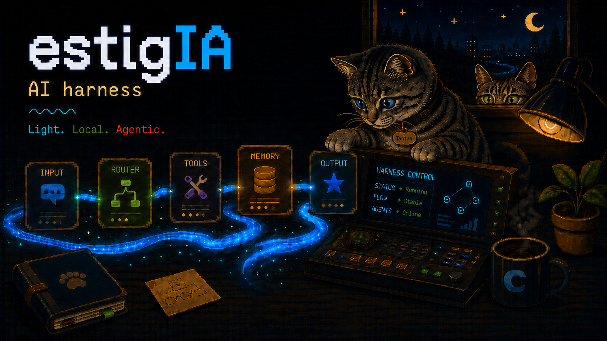
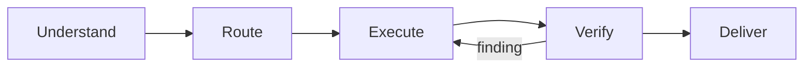
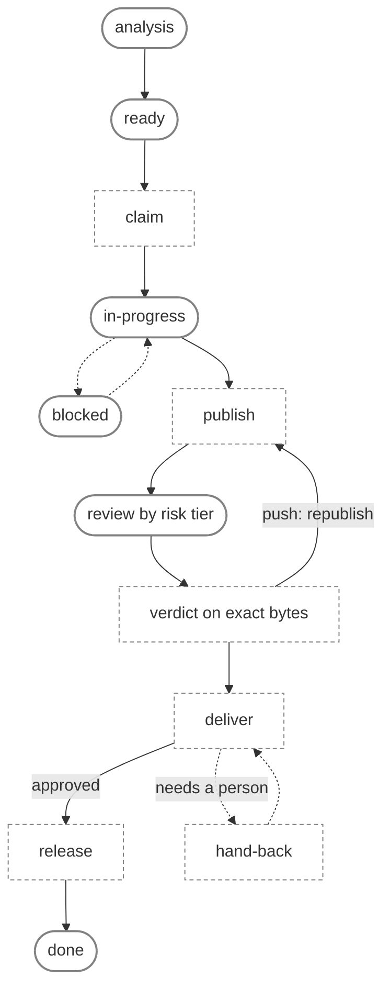

<p align="center">
  
</p>

<p align="center">
  <a href="https://github.com/asanabrial/estigia/actions/workflows/ci.yml"></a>
  <a href="LICENSE"></a>
  <a href="https://www.rust-lang.org"></a>
  <a href="#the-tools"></a>
  <a href="#install"></a>
  <a href="https://glama.ai/mcp/servers/asanabrial/estigia"></a>
</p>

---

# estig**IA** — workflow authority for AI coding agents

Your agent says it claimed the issue, that the review passed, that the branch is current. Estigia
turns those sentences into things that were checked: the claim lives in a local store
(`~/.estigia/state.db`), every later write is measured against it, every step that cannot be undone
re-verifies it, and a review verdict is bound to exact bytes, so a push invalidates it.

One binary, under whatever agent you already use; it does not run your model. Its only detached
processes are a reviewer CLI and the declared checks ([which](docs/what-it-writes.md#which-processes-estigia-launches)).

> *El río del juramento. Lo que un agente promete, queda ligado a unos bytes exactos.*

**Leteo** is the river of forgetting. **Estigia** is the river of the oath — the gods swore by its
waters, and perjury cost nine years outside Olympus. Two rivers of the same underworld, opposite jobs:
one makes you forget, the other holds you to it.

## What it feels like

Mostly, nothing: a run that has claimed nothing works as before. When it refuses, it says what it
read and what to do about it:

```
$ git push origin HEAD
estigia: git push: gh issue view failed (1): none of the git remotes ... (read-failed)
  [world-action] the tracker could not be read; write nothing and retry the read
error: failed to push some refs
```

*The tracker could not be read* is a different answer from *you may not push*, and Estigia will not
turn the first into the second. That distinction is most of the design.

## FLOW — Fast, Lean, Outcome-driven Workflow

**FLOW is Estigia's own methodology: how a run takes a piece of work from an issue to a merge.**

- **Fast:** small work stays small. Understood work is done directly, not planned.
- **Lean:** one writer, the smallest topology that works, and review only as heavy as the risk.
- **Outcome-driven:** done means the issue's acceptance criteria hold, with evidence, merged and verified.

It rests on two pillars: *the claimed issue is the record of the work*, and *the publication is the
review candidate*. Four principles follow from them: small work stays small; review is sized by risk;
a review lineage gets a bounded number of corrections (`Corrections per lineage`, default 3); and the
heavyweight two-judge review (Judgment Day) runs only when asked for.

You start it with `flow` (analyse and build, choosing the next issue from the tracker), `flow dev
[issue]` (build) or `flow triage` (analyse and file at most one evidenced issue). A run then goes
through five steps, which may merge or repeat:



| Step | What happens |
|---|---|
| **Understand** | Read only; explore in proportion; at most one product question and one challenge to a premise. |
| **Route** | Do it directly when it is understood; plan briefly only for real uncertainty; delegate only for a stated reason. |
| **Execute** | Bounded changes, Conventional Commits, test-first wherever a deterministic test applies. |
| **Verify** | Deterministic evidence first, then the review: none, one or four sealed lenses by risk tier, by a context that did not write the change. |
| **Deliver** | `deliver` records the verdict, waits for CI, merges at the reviewed head and closes with evidence — or hands the decision back. |

Work that spans sessions or divides into units with their own acceptance keeps an ordered checklist
on the claimed issue (`task`), never in a file. FLOW is how a run works; the workflow below is what
Estigia enforces while it does.

## The workflow

The workflow is the part a run cannot talk its way around: the states an issue moves through and the
checks at each boundary. FLOW runs inside it.



Rounded nodes are states, square nodes are actions; dotted edges are the exceptions. What the gate
holds at each boundary:

- **One state at a time**, in the local store; labels are a projection, written and read back.
  `blocked` names an exact exit condition and who discharges it.
- **A claim before the first write.** The earliest live claim wins, and the gate re-verifies it on
  every write it sees and at every irreversible step.
- **A verdict bound to exact bytes** — epoch, head, base and digest. Any push invalidates it:
  republish and ask again. A body says `Refs #<n>`, never a closing keyword.
- **Release last**, after the evidence is posted ([details](docs/what-it-writes.md#a-run-id-release-and-prune)).

The contract an agent reads is [`skill/SKILL.md`](skill/SKILL.md#flow); the GitHub half is
[`delivery.md`](skill/bindings/github/delivery.md); review cost per tier is in
[`review-cost.md`](docs/review-cost.md).

## Install

Pick one route. Each is copy-paste.

Linux, macOS:

```sh
curl -fsSL https://raw.githubusercontent.com/asanabrial/estigia/main/scripts/install.sh | sh
```

Windows (PowerShell):

```powershell
irm https://raw.githubusercontent.com/asanabrial/estigia/main/scripts/install.ps1 | iex
```

npm (installs and sets up in one step):

```sh
npx -y @asanabrial/estigia setup --all
```

Cargo (needs Rust):

```sh
cargo install estigia
```

Then register it in your agents, and check:

```sh
estigia setup --all      # or: estigia tui
estigia status
estigia doctor
```

Linux archives need glibc 2.39+ (not Debian 12, Ubuntu 22.04, RHEL 9); there, use `cargo install estigia`.
The installers check the archive against its published checksum and refuse a mismatch. The binary
lands in `~/.local/bin/estigia` (`%LOCALAPPDATA%\estigia\bin\estigia.exe` on Windows);
`ESTIGIA_INSTALL_DIR` moves it and `ESTIGIA_VERSION` takes a tag other than the latest. The npm
package carries no binary: it fetches the same archive, and it is what the
[MCP registry](https://registry.modelcontextprotocol.io) entry starts (`mcp-name: io.github.asanabrial/estigia`). A source build has no installer record, so the
commands that write into your agents ask for `--allow-source-build` ([why](docs/lifecycle.md));
`cargo install --git https://github.com/asanabrial/estigia` takes main. The [`Dockerfile`](Dockerfile)
builds a server-only image; none is published.

## Set it up in your agents

Installing the binary changes nothing on its own.

1. `estigia tui` opens the setup screen; `s` shows what it will write. Without it:
   `estigia setup claude-code` for one agent, `estigia setup --all` for all; `--dry-run` on either
   writes nothing.
2. Optionally route a role to a model, the spelling the screen ends by printing:

   ```sh
   estigia config set "Model routing" "developer=inherit" --agent claude-code
   ```

3. In a repository where any agent may write, `estigia guard` installs a `pre-push` hook that refuses a
   push no live claim authorises, whoever typed it.

`setup` installs the skill, a directive in the agent's instruction file and the hooks, which go into
every agent with an event able to refuse — five of them, in a gate that reads five dialects. What else it
writes is in [what it writes](docs/what-it-writes.md#what-setup-installs-besides-the-skill-and-what-the-hosts-permission-mode-does-not-change).

## Verify

1. `estigia status`: what is installed, where, and whether each agent is told (`tools on`) and stopped
   (`gate on`).
2. `estigia doctor`: skill, gh, remote, guard, prune, permission and the rest, read-only.
3. `estigia sessions`, `feed`, `where`, `needs-person` and `changes` (uncommitted work) are read-only too.

## Uninstall

Uninstall removes what Estigia created and nothing else: not another tool's block, not your notes, not
a file of its own you have since edited, which it keeps and names. Run in this order:

```sh
estigia uninstall --all --dry-run   # changes nothing; says what the next line will do
estigia uninstall --all             # or: estigia uninstall claude-code
estigia guard --uninstall           # in each repository with the push guard
estigia config forget               # in each checkout
cargo uninstall estigia             # source build only; otherwise delete the binary
rm -rf ~/.estigia                   # optional, read the warning first
```

1. The dry run is safe to repeat; `estigia uninstall claude-code` leaves the other agents alone.
2. `uninstall --all` takes Estigia out of every agent.
3. `guard --uninstall` removes only a hook Estigia wrote, and must go before the binary, which the
   hook calls.
4. `config forget` removes `<checkout>/.git/estigia/`, the repository settings every uninstall
   survives; it says which file it removed.
5. Remove the binary by the route you installed with. Installer script or npm: delete
   `~/.local/bin/estigia` (or `$ESTIGIA_INSTALL_DIR/estigia`); on Windows delete
   `%LOCALAPPDATA%\estigia\bin\estigia.exe` (or under `%ESTIGIA_INSTALL_DIR%`) and take that directory
   out of the user `PATH`. A source build: `cargo uninstall estigia`.

**Before `rm -rf ~/.estigia`:** `state.db` is the workflow store, one copy on this machine: claims,
states, receipts, findings, verdicts, spend, tasks, the decision history, the session registry and the
mailbox. Beside it: run pointers; `jobs/`; `snapshots/` (up to three copies of the store);
`lifecycle/` (the binary's provenance records); `workspaces/` and `roots/`; the screen's language; your
checkouts list. The last `uninstall --all` takes the store and the run state and keeps the rest
([per entry](docs/what-it-writes.md#what-estigia-holds-and-what-each-uninstall-step-leaves)). Delete it
only when you no longer want the history of what this machine's gate decided.

What `REPLACE` and `OVERWRITE` mean is in [`docs/what-it-writes.md`](docs/what-it-writes.md).

## A harness, not a document

The contract under `skill/` is text an agent may ignore, so Estigia holds the tools: a `PreToolUse`
gate, a `Stop` hook, a `pre-push` hook under git, and forty-five operations with schemas below. The local store is the
authority; the tracker keeps a projection that never decides. The diagram, the loop plugins and the
gate's rules are in [what it writes](docs/what-it-writes.md#the-gate-the-hooks-and-the-loop-plugins).

## The tools

Forty-five operations, table-driven. Thirty-eight map to operations the binding must provide;
`send_message`, `inbox`, `list_sessions`, `feed`, `where` and `status` are answered by the local store and `deliver` composes
the rest with the merge gate, outside the binding. `tools/list` carries each schema and a
`readOnlyHint`. The eleven delivery tools (`claim`, `start_branch`, `publish_review`,
`launch_review_input`, `collect_review_input`, `record_computed_verdict`, `release_ci`, `deliver`,
`release`, `transition`, `review_status`) carry `_meta["anthropic/alwaysLoad"]`; every tool takes
`compact` ([cost](docs/review-cost.md#what-the-tool-menu-itself-costs)):

```
read   verify_claim
read   list_state
read   check_closing_keywords
read   review_status
read   review_read
read   review_tier
read   target
read   tasks
read   list_sessions
read   feed
read   where
WRITE  claim
WRITE  handoff
WRITE  heartbeat
WRITE  transition
WRITE  comment
WRITE  blocked_until
WRITE  task
WRITE  send_message
WRITE  inbox
WRITE  status
WRITE  release
WRITE  ensure_states
WRITE  flush
WRITE  start_branch
WRITE  judge_workspaces
WRITE  assist
WRITE  draft_pr
WRITE  ready_pr
WRITE  review_stages
WRITE  review_thread
WRITE  create
WRITE  publish_review
WRITE  republish_review
WRITE  handoff_review
WRITE  record_review_finding
WRITE  record_disposition
WRITE  launch_review_input
WRITE  collect_review_input
WRITE  record_computed_verdict
WRITE  escalate_review
WRITE  record_spend
WRITE  release_ci
WRITE  deliver
WRITE  run_checks
```

Forty-five tools. The contract names seventeen operations every binding must map; the tools absorbed some
under a surviving name ([why](docs/github-binding.md#why-the-transport-is-in-this-process-and-why-the-server-is-hand-written)).
Arguments are in each tool's schema.

## Configuration

Thirty-one typed settings, in [`docs/configuration.md`](docs/configuration.md), grouped by theme and shown
in one order by `estigia config list`, the setup screen and the reference alike. Each row says whose
answer it is: this agent's, this repository's, every checkout's or this machine's.

## The ratchet

A message may name a command only when running it discharges the block; a refusal carries a typed code
and a runnable resolution ([classes](docs/refusal-classes.md#the-ratchet-and-what-it-was-started-from)):

```
  run: estigia setup --all   # or one of: agents, claude-code, codex, opencode, pi, cursor, zcode, deepseek-harness
```

## What this instrument does not measure

[`docs/honesty.md`](docs/honesty.md) names what this crate does **not** check, each with the
measurement that found it; [`docs/README.md`](docs/README.md) maps the rest of the set.

## Layout

```
src/harness/   the gate, the run pointer, the transport, the lifecycle protocol, doctor
src/setup/     agent adapters, companions, dry-run, exact inverse
src/config/    typed model, the settings table as data
src/cli/       dispatch, and the only place a refusal becomes an exit code
skill/         SKILL.md, bindings/, policies/, protocols/, references/, assets/, agents/ — not compiled
docs/          the reference the sections above point at, one question each
scripts/       the two installers a release is fetched with, and the Windows source reinstall
```

[`AGENTS.md`](AGENTS.md) — which `CLAUDE.md` is a link to — is how an agent works here.

## Exit codes

Four, and none of them means "something went wrong":

| Code | Meaning |
|---|---|
| `0` | the command did what it said |
| `1` | the command refused; the refusal says whether anything **had already been written** |
| `2` | the world may have changed and this process cannot tell |
| `3` | the invocation could not be read: nothing was attempted, and **nothing was decided** |

Why there are four: [`docs/refusal-classes.md`](docs/refusal-classes.md#the-exit-codes-and-why-there-are-four).

## Licence

MIT. Files derived from another MIT-licensed project carry its notice in [`THIRD_PARTY_NOTICES.md`](THIRD_PARTY_NOTICES.md).
